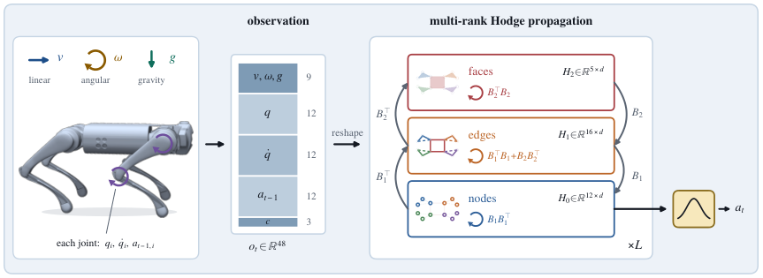
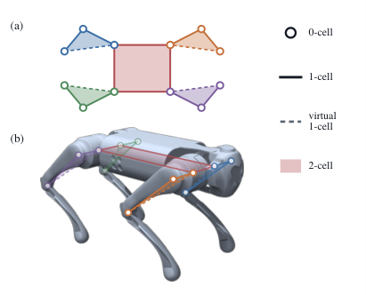

# Higher-Order Morphology Priors for Quadruped Reinforcement Learning Under Actuator Degradation

**[Derek You](https://github.com/dh-you)<sup>*1</sup>, Zafir Shamsi<sup>*2</sup>, Keqin Wang<sup>*&dagger;3</sup>, [Christine Allen-Blanchette](https://cablanchette.github.io/)<sup>&dagger;3</sup>**

<sup>1</sup>Edison Academy Magnet School &nbsp;&middot;&nbsp; <sup>2</sup>South Brunswick High School &nbsp;&middot;&nbsp; <sup>3</sup>Princeton University  
<sub><sup>*</sup>Equal contribution. Work done during the Princeton Laboratory Learning Program. &nbsp;&middot;&nbsp; <sup>&dagger;</sup>Correspondence: `{keqin.wang, ca15}@princeton.edu`</sub>

**[IROS 2026 Workshop on Hybrid Architectures for Embodied Autonomy: Bridging Learning, Planning, and Control (BLPC 2026)](https://sites.google.com/bu.edu/hybridarchforautonomy) — Spotlight Paper**

[](https://arxiv.org/abs/2610.10934)
[](https://arxiv.org/pdf/2610.10934.pdf)
[](https://dh-you.github.io/hodge-morphology-degradation-RL/)
[](https://sites.google.com/bu.edu/hybridarchforautonomy)

<p align="center">
  
</p>

## Abstract

Actuator degradation turns quadruped locomotion into a coordination problem requiring joints to compensate for lost actuation. Prior work suggests that morphology-aware graph policies improve learning and generalization under body perturbations. We ask whether these benefits can be strengthened by explicitly modeling higher-order mechanical structure. We represent the Unitree Go1 as a cell complex with limb- and body-level rank-2 cells and apply Hodge-based message passing. Under degradation training, the node-edge-face Hodge actor achieves the highest return on unseen actuator degradations, with higher survival and lower velocity-tracking error. These results support higher-order morphology as a useful inductive bias for whole-body compensation under actuator degradation.

## Method Overview

<p align="center">
  
</p>

We represent the 12-DoF Unitree Go1 as a cell complex with **12 nodes** (actuated joints, 0-cells), **16 edges** (8 serial kinematic couplings, 4 hip-ring couplings, and 4 virtual limb closures, 1-cells), and **5 faces** (4 limb cells and 1 coplanar hip body cell, 2-cells), encoded by fixed incidence matrices $B_1 \in \mathbb{R}^{12 \times 16}$ and $B_2 \in \mathbb{R}^{16 \times 5}$.

We compare five parameter-matched actor architectures (all within 0.5% of 171,296 parameters) sharing the same privileged PPO critic and 400M-step training budget across seeds `{11, 12, 13}`:

| Actor | Canonical Name | Family | Parameters |
|---|---|---|---:|
| **MLP-C** | `native_mlp_w480_240_120` | Centralized MLP | 170,784 |
| **MLP-D** | `pointwise_w252` | Factorized per-joint MLP | 171,478 |
| **GCN** | `gcn_w1107` | Graph Convolutional Network | 171,361 |
| **Hodge-L** | `multirank_hodge_lower_w177` | Node-Edge Hodge (ranks 0–1) | 171,705 |
| **Hodge-F** | `multirank_hodge_full_w150` | Node-Edge-Face Hodge (ranks 0–2) | 171,296 |

## Experimental Results

### In-Regime Evaluation ($H \to H$ and $D \to D$)

| Actor | $H \to H$ Return $\uparrow$ | $H \to H$ Survival $\uparrow$ | $H \to H$ Vel. RMSE $\downarrow$ | $D \to D$ Return $\uparrow$ | $D \to D$ Survival $\uparrow$ | $D \to D$ Vel. RMSE $\downarrow$ |
|---|---|---|---|---|---|---|
| **MLP-C** | **33.88 ± 0.03** | 1.00 ± 0.00 | **0.052 ± 0.001** | 19.98 ± 0.50 | 0.88 ± 0.02 | 0.324 ± 0.003 |
| **MLP-D** | 31.17 ± 0.15 | 1.00 ± 0.00 | 0.060 ± 0.001 | 18.15 ± 1.09 | 0.83 ± 0.06 | 0.320 ± 0.008 |
| **GCN** | 24.52 ± 0.07 | 1.00 ± 0.00 | 0.302 ± 0.001 | 15.35 ± 0.21 | 0.73 ± 0.01 | 0.339 ± 0.001 |
| **Hodge-L** | 32.30 ± 0.27 | 1.00 ± 0.00 | 0.057 ± 0.002 | 18.61 ± 1.79 | 0.83 ± 0.09 | 0.325 ± 0.008 |
| **Hodge-F (Ours)** | 32.58 ± 0.53 | 1.00 ± 0.00 | 0.056 ± 0.002 | **22.40 ± 0.63** | **0.94 ± 0.01** | **0.252 ± 0.036** |

### Cross-Regime Evaluation ($H \to D$ and $D \to H$)

| Actor | $H \to D$ Return $\uparrow$ | $H \to D$ Survival $\uparrow$ | $H \to D$ Vel. RMSE $\downarrow$ | $D \to H$ Return $\uparrow$ | $D \to H$ Survival $\uparrow$ | $D \to H$ Vel. RMSE $\downarrow$ |
|---|---|---|---|---|---|---|
| **MLP-C** | **16.89 ± 0.10** | 0.69 ± 0.05 | 0.205 ± 0.005 | 24.85 ± 0.21 | 1.00 ± 0.00 | 0.306 ± 0.001 |
| **MLP-D** | 13.87 ± 0.41 | 0.57 ± 0.03 | 0.208 ± 0.003 | 24.74 ± 0.32 | 1.00 ± 0.00 | 0.307 ± 0.004 |
| **GCN** | 12.99 ± 0.28 | **0.70 ± 0.02** | 0.342 ± 0.009 | 23.83 ± 0.18 | 1.00 ± 0.00 | 0.307 ± 0.001 |
| **Hodge-L** | 15.32 ± 0.92 | 0.63 ± 0.03 | **0.195 ± 0.017** | 24.87 ± 0.31 | 1.00 ± 0.00 | 0.311 ± 0.000 |
| **Hodge-F (Ours)** | 15.59 ± 1.16 | 0.60 ± 0.03 | 0.207 ± 0.001 | **27.17 ± 1.73** | 1.00 ± 0.00 | **0.220 ± 0.060** |

## Quick Start

Training and evaluation use Python 3.12 and `uv`:

```bash
cd code/go1-robot-experiments-2x2
uv sync --frozen
pip install ../go1-morphology-core
```

Link pinned MuJoCo Menagerie assets:

```bash
uv run python scripts/link_pinned_menagerie.py \
  --source /path/to/mujoco_playground/mujoco_playground/external_deps/mujoco_menagerie \
  --replace-installed-copy
```

Train a model (Cell D / degraded curriculum or Cell A / healthy curriculum):

```bash
# Degraded curriculum (D):
uv run python scripts/train_double_actuator_d.py \
  --model multirank_hodge_full_w150 --seed 11 --output-root runs/cell_d

# Healthy curriculum (H):
uv run python scripts/train_healthy_a.py \
  --model multirank_hodge_full_w150 --seed 11 --output-root runs/cell_a
```

## Repository Layout

| Path | Purpose |
|---|---|
| `code/go1-morphology-core/` | Frozen model library (`v1.0.0`) — architectures, cell-complex topology, PPO networks |
| `code/go1-robot-experiments-2x2/` | Training, evaluation, and post-processing scripts for the $2 \times 2$ study |
| `results/` | Paper-ready tables, learning curves, and severity-sweep figures |
| `index.html`, `static/` | Academic project page |

## Citation

```bibtex
@inproceedings{you2026higherorder,
  title={Higher-Order Morphology Priors for Quadruped Reinforcement Learning Under Actuator Degradation},
  author={You, Derek and Shamsi, Zafir and Wang, Keqin and Allen-Blanchette, Christine},
  booktitle={IROS Workshop on Hybrid Architectures for Embodied Autonomy: Bridging Learning, Planning, and Control (BLPC)},
  year={2026},
  note={Spotlight Paper, arXiv:2610.10934},
  url={https://arxiv.org/abs/2610.10934}
}
```
